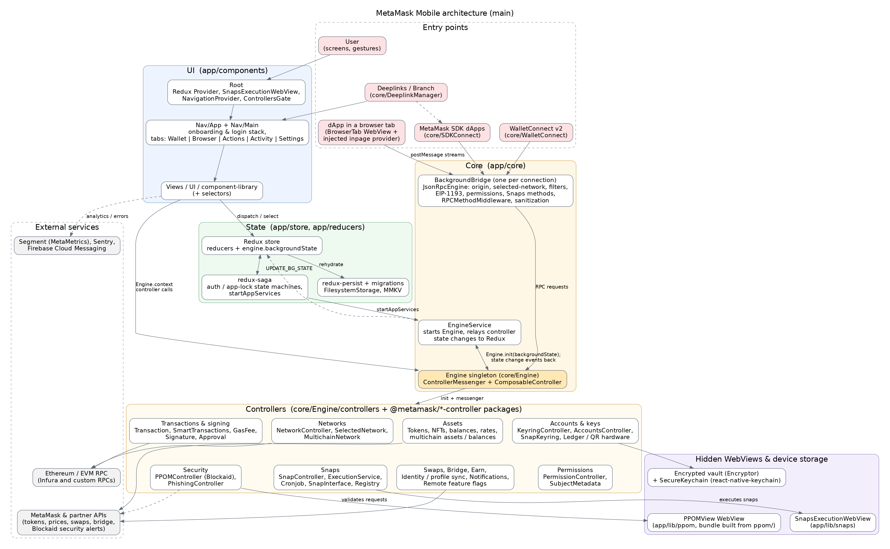

### Architecture

This page describes how the app on `main` is put together today. The diagram is rendered from [`docs/diagrams/architecture.dot`](../diagrams/architecture.dot) (Graphviz); edit that file and run `docs/diagrams/render.sh` to regenerate [`architecture.png`](../diagrams/architecture.png) and [`architecture.svg`](../diagrams/architecture.svg).

> The older `architecture.svg` in the repository root is a 2020 draw.io diagram (GABA controllers, InstaPay, a single JSON-RPC engine). It no longer matches the code; use the diagram above.

#### Layers

| Layer | Where | What it does |
| --- | --- | --- |
| UI | `app/components` (`Nav`, `Views`, `UI`), `app/component-library`, `app/selectors` | React Native screens. `Views/Root` mounts the Redux `Provider`, the hidden `SnapsExecutionWebView`, `NavigationProvider` and `ControllersGate`; `Nav/App` holds the onboarding/login stack and `Nav/Main` the tab navigator (Wallet, Browser, Actions, Activity, Settings). |
| State | `app/store`, `app/reducers`, `app/actions` | Redux Toolkit store with `redux-saga` and `redux-thunk`. `redux-persist` (with `app/store/migrations`) rehydrates state from `FilesystemStorage`; `storage-wrapper.ts` wraps MMKV. Controller state is mirrored into `engine.backgroundState`. |
| Startup | `app/store/sagas`, `app/core/EngineService` | The `startAppServices` saga waits for persisted state, then calls `EngineService.start()`, which runs `Engine.init(backgroundState)` and subscribes to every controller state-change event (`BACKGROUND_STATE_CHANGE_EVENT_NAMES`) to dispatch `UPDATE_BG_STATE` into Redux. If init fails, the app routes to vault recovery. |
| Engine | `app/core/Engine` | Singleton that builds every controller around one `ExtendedControllerMessenger` and combines their state with a `ComposableController`. Newer controllers are created through `initModularizedControllers` with an init function in `Engine/controllers` and a restricted messenger in `Engine/messengers` (see [`app/core/Engine/README.md`](../../app/core/Engine/README.md)). UI code reaches controllers through `Engine.context`. |
| dApp connections | `app/core/BackgroundBridge`, `app/core/RPCMethods`, `app/core/Permissions` | One `BackgroundBridge` per connection. Each builds a `JsonRpcEngine` whose middleware runs in this order: origin, selected-network, logger, filter and subscription, unsupported-method, EIP-1193 and `eth_accounts`, Sentry tracing, `PermissionController`, Snaps methods, `RPCMethodMiddleware`, sanitization; requests then reach the controllers and the network provider. The Snaps RPC middleware is enabled for the in-app browser only, not for WalletConnect or SDK connections. |
| Entry points | `app/components/Views/BrowserTab`, `app/core/SDKConnect`, `app/core/WalletConnect`, `app/core/DeeplinkManager` | In-app browser tabs (WebView with the provider injected by `EntryScriptWeb3`, built from `scripts/inpage-bridge`), MetaMask SDK connections (deeplink and Android service), WalletConnect v2 sessions, and Branch/universal deeplinks. |
| Snaps | `app/core/Snaps`, `app/lib/snaps`, `Engine/controllers/snaps` | `SnapController`, `ExecutionService` (`WebViewExecutionService`), `CronjobController`, `SnapInterfaceController` and `SnapsRegistry` (build-time flags `preinstalled-snaps`, `external-snaps`). Snaps run inside the hidden `SnapsExecutionWebView`; keyring snaps power non-EVM accounts through `SnapKeyring` and the multichain controllers. |
| Transaction security | `app/lib/ppom`, `ppom/` | `PPOMController` (`@metamask/ppom-validator`) validates requests with Blockaid's PPOM, which runs in the hidden `PPOMView` WebView. `ppom/` is a separate webpack project that bundles the PPOM WASM into `app/lib/ppom/ppom.html.js`; `yarn setup` builds it. |
| Keys and secrets | `app/core/Vault.js`, `app/core/Encryptor`, `app/core/SecureKeychain.js`, `app/core/Authentication` | `KeyringController` stores the encrypted vault; the password is kept in the device keychain via `react-native-keychain`. Ledger and QR (Keystone) hardware keyrings are supported. |

#### Controllers

| Group | Controllers |
| --- | --- |
| Accounts and keys | `KeyringController`, `AccountsController`, `AccountTrackerController`, `SnapKeyring`, Ledger / QR keyrings |
| Networks | `NetworkController`, `SelectedNetworkController`, `MultichainNetworkController` |
| Transactions and signing | `TransactionController`, `SmartTransactionsController`, `GasFeeController`, `SignatureController`, `ApprovalController` |
| Assets | `TokensController`, `TokenListController`, `TokenDetectionController`, `TokenBalancesController`, `TokenRatesController`, `NftController`, `NftDetectionController`, `CurrencyRateController`, multichain assets / balances / rates / transactions controllers |
| Permissions | `PermissionController`, `SubjectMetadataController` |
| Security | `PPOMController`, `PhishingController` |
| Other features | `SwapsController`, `BridgeController`, `BridgeStatusController`, `EarnController`, `AuthenticationController` and `UserStorageController` (profile sync), `NotificationServicesController`, `NotificationServicesPushController`, `RemoteFeatureFlagController`, `AddressBookController`, `PreferencesController`, `LoggingController` |

#### Other top-level directories

| Path | Purpose |
| --- | --- |
| `android/`, `ios/` | Native projects; `scripts/build.sh` drives native builds and Metro. |
| `ppom/` | Blockaid PPOM WebView bundle (see above). |
| `e2e/` | Detox end-to-end tests (`e2e/specs`), fixtures and page objects. |
| `wdio/` | Appium + WebdriverIO + Cucumber tests for app launch times and upgrades (`wdio.conf.js`, `wdio/config`). |
| `locales/` | i18n strings. |
| `scripts/` | Setup (`setup.mjs`), build, release and CI helpers. |
| `.github/scripts/` | GitHub Actions helpers and fitness functions. |
| `bitrise.yml` | Bitrise CI pipelines for builds and E2E runs. |
